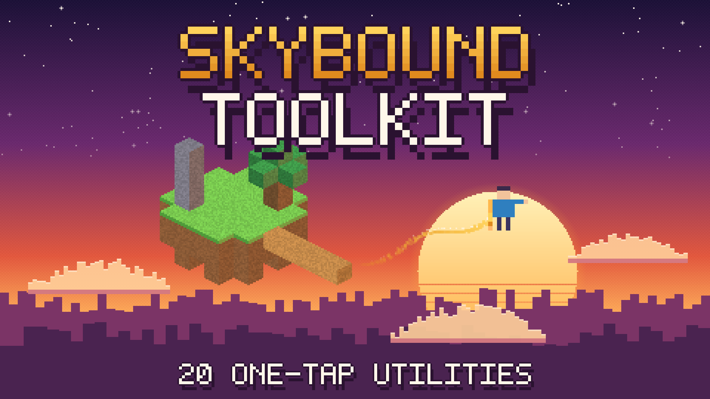

# Skybound Toolkit

Fly, bridge, climb and light up the dark. **Skybound Toolkit** is a family-friendly add-on for Minecraft Bedrock Edition with 20 one-tap utilities for your own worlds, plus gadgets and opt-in 3x3 tunnel mining.

## Download

**[Download Skybound Toolkit 1.12.0 (.mcaddon)](https://github.com/Reality-Realms/bedrock-utility-pack-downloads/releases/download/v1.12.0/Skybound-Toolkit-v1.12.0.mcaddon)**

All files: [Releases](https://github.com/Reality-Realms/bedrock-utility-pack-downloads/releases)

> **Test candidate.** It passes automated checks but has not been fully tested in Minecraft on every device. Back up your world first.

## Install

1. Back up your world.
2. Download the `.mcaddon` file and open it. Minecraft imports both packs.
3. In your world settings, activate **Skybound Toolkit 1.12.0** and its matching **Resources** pack. Remove any older "Bedrock Utility Pack" pair.
4. Enable Beta APIs / scripting if Minecraft asks.
5. In game, type `/sky:menu`. Open a category and tap a utility to switch it ON or OFF. Use `/sky:off` to stop everything, and `/sky:menustyle` to switch between the full-screen and classic menu.

## Safety and privacy

- No ads, tracking, accounts, payments or network requests.
- Settings are stored only in your world.
- No combat automation or cheating features.

## Checksum

SHA-256 of the `.mcaddon`: `FF3E41DD58CEB824EB1BD282894B7E6ADF3D19A5AFA2304C2F8B8F1E18CB56C1`

Not an official Minecraft product. Not approved by or associated with Mojang or Microsoft.
